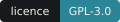
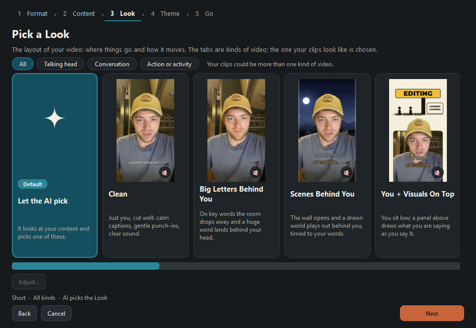
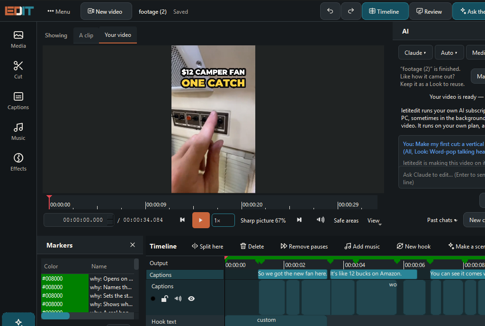
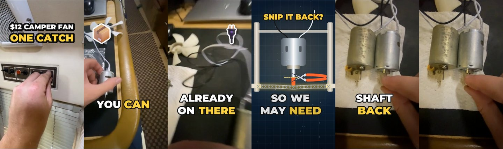

  <picture>
    <source media="(prefers-color-scheme: dark)" srcset="src/icons/letitedit/letitedit_logo_dark-bg.svg">
    
  </picture>

<h3 align="center">An open-source video editor, with your own AI inside.</h3>

  Your AI cuts your video on a real timeline. Open it and change anything, one Undo per step.

  
  
  

  <a href="https://github.com/letitedit/letitedit/releases/download/v1.0.0-beta-20261126.6/letitedit-Setup-1.0.0-20261126.6.exe"><b>&#11015;&nbsp; Download for Windows</b></a>
  &nbsp;&middot;&nbsp; letitedit 1.0.0-beta-20261126.6, 587 MB
  &nbsp;&middot;&nbsp; <a href="https://github.com/letitedit/letitedit/releases/tag/v1.0.0-beta-20261126.6">release notes and checksums</a>
  &nbsp;&middot;&nbsp; <a href="https://letitedit.app">letitedit.app</a>

  

## What it is

letitedit is a custom build of the [Shotcut](https://www.shotcut.org) video editor with a tool server and editing skills
that your own AI uses: **Claude Code, Codex or Antigravity**, already on your PC, with your own subscription. Point it at
a folder of clips, pick a Look (or let the AI pick), and it makes the video: it reads what was said, cuts, adds captions,
music, graphics and effects, and checks the export before it hands it over. What you get is not just an MP4. It's a
project on a real timeline, with every AI change as one step you can undo or redo by hand.

  

  
   Frames from a Short letitedit made from a folder of phone clips, in the Word-pop Look.

## How it works

- **Bring your own AI.** Claude Code, Codex or Antigravity on your PC does the editing, on your own plan. You pay Anthropic, OpenAI or Google directly; letitedit adds no credits and needs no account.
- **A real timeline.** Every edit the AI makes lands in the editor as one Undo step. Drag a clip, trim a caption, or ask the AI for the next change.
- **About 90 video tools.** Footage logging, speech to text, cuts by script, captions placed clear of faces, music fitted to the cut, Looks, motion graphics, cut-outs, a mix at web loudness, and a review of the export.
- **Heavy work on your PC.** Speech to text, picture analysis, cut-outs and the like run on free local models. Each downloads from its maker the first time a feature needs it.
- **Free and open source.** The editor, the AI tools and the core skills are GPL-3.0.

**Windows warns you once.** The installer isn't code-signed yet, so Windows shows "Windows protected your PC" the first
time. Click **More info**, then **Run anyway**.

## What's bundled

letitedit puts together a long stack of open-source software that you would otherwise gather, patch and keep working
yourself. Everything below ships in the installer or downloads from its maker the first time a feature needs it.
Every part keeps its own licence; the full list with versions, copyright holders and sources is
[THIRD-PARTY-NOTICES.md](THIRD-PARTY-NOTICES.md).

### Editing and rendering engine (in the installer)

| Part | What it does for you | Licence |
|---|---|---|
| letitedit editor, based on Shotcut 26.9.27 | The window: player, timeline, panels and the AI chat | GPL-3.0-or-later |
| MLT 7.41.0, with letitedit's six patches | Plays and exports every edit; fonts, captions and memory fixes in the patches | LGPL-2.1-or-later, GPL modules |
| FFmpeg 9.0 | Reads and writes nearly every video and audio format | GPL-3.0 (as built) |
| x264, x265 | H.264 and HEVC video | GPL-2.0-or-later |
| libvpx, aom, dav1d, SVT-AV1, Opus, Vorbis | VP9, AV1, Opus and Vorbis | BSD |
| Qt 6.11 | The interface toolkit | LGPL-3.0 |
| frei0r, Movit, Rubber Band, vid.stab, SoX, LADSPA SWH, bigsh0t | Video effects, GPU filters, time stretching, stabilising, audio filters, 360° video | GPL-2.0-or-later, LGPL |
| OpenCV | Picture analysis inside the engine | Apache-2.0 |
| whisper.cpp 1.8 | Speech to text inside the editor | MIT |
| Glaxnimate 0.5 | Animated vector titles | GPL-3.0 |
| Lottie elements, Noto animated emoji | Ready-made animated titles, transitions and emoji | Lottie Simple License; CC BY 4.0 (a video using them owes a credit) |
| Mesa llvmpipe, Microsoft WebView2 loader | Drawing without a graphics driver; the in-app web panels | MIT; BSD-3-Clause |

About fifty more libraries come with them (ICU, cairo, FreeType, HarfBuzz, SDL2 and others): each program file's origin
is in [release/source/app-binaries-manifest.tsv](release/source/app-binaries-manifest.tsv).

### Local AI and media models (downloaded on first use)

| Model | What it does for you | Licence |
|---|---|---|
| Whisper large-v3-turbo; faster-whisper medium.en and tiny.en; whisper.cpp base.en | Speech to text, with word times, in any language or English | MIT |
| Qwen3.5-4B (vision) | Looks at your footage to describe and find moments | Apache-2.0 |
| CLIP ViT-B-32; BAAI bge-small-en-v1.5 | Searching pictures and text by meaning | MIT |
| CLAP; PANNs Cnn14 | Naming the sounds in a clip | Apache-2.0; CC BY 4.0 |
| SpeechBrain ECAPA | Telling speakers apart | Apache-2.0 |
| Demucs htdemucs; DBS-TIGER-DnR | Splitting voice, music and effects | MIT; Apache-2.0 |
| DeepFilterNet | Cleaning up a noisy voice | MIT or Apache-2.0 |
| Beat This! (in the installer) | Finding the beat, to cut music on it | MIT |
| Kokoro-82M; Chatterbox; dots.tts-soar | Voiceovers and dubbing on your PC | Apache-2.0; MIT; Apache-2.0 |
| ACE-Step 1.5 | Making music for your video | MIT |
| BiRefNet-lite; MODNet | Cutting a person or object out of the background | MIT; Apache-2.0 |
| SAM 2 Tiny; OpenCV Zoo YuNet, SFace, VitTrack | Following an object or a face through a shot | Apache-2.0; MIT, Apache-2.0 |
| LaMa; Depth Anything V2 Small; sky segmentation | Removing objects, depth for effects, replacing a sky | Apache-2.0; Apache-2.0; MIT |
| Real-ESRGAN; SCUNet | Upscaling and denoising | BSD-3-Clause; Apache-2.0 |
| FFmpeg 8.1 with vid.stab | Stabilising shaky footage | GPL-3.0 |
| GeoNames; Natural Earth | Place names and maps | CC BY 4.0 (credit needed); public domain |

### Motion, graphics, audio and fonts (in the installer)

| Part | What it does for you | Licence |
|---|---|---|
| HyperFrames 0.8 and its 76 npm packages | Motion clips and animated scenes, drawn with your PC's own Edge or Chrome | Apache-2.0; MIT, ISC, BSD (sharp's libvips LGPL-3.0) |
| anidoodle's music engine and drawing code | Music written as a score for your cut; hand-drawn styles for scenes | Apache-2.0 |
| 316 font families from Google Fonts, plus any other family on demand | Captions and titles | SIL OFL-1.1, Apache-2.0, Ubuntu Font Licence |
| Microsoft Fluent Emoji; Tabler Icons | Emoji and icons for pop-ups and graphics | MIT |
| About 800 sound effects and 32 starter songs | Whooshes, hits and music you can use anywhere | CC0 / public domain |

### Runtimes and tooling

| Part | What it does for you | Licence |
|---|---|---|
| letitedit's tool server and skills | The tools and editing know-how your AI uses, over the Model Context Protocol | GPL-3.0-or-later |
| Python 3.14 and uv (set up by the installer) | Runs the tool server in its own copy of Python, apart from yours | PSF-2.0; MIT or Apache-2.0 |
| MCP Python SDK, NumPy, SciPy, Pillow, ONNX Runtime, CTranslate2, PyAV and about 70 more | The tool server's building blocks | MIT, BSD, Apache-2.0 (PyAV bundles GPL FFmpeg) |
| espeak-ng with phonemizer; Praat via Parselmouth | Pronunciation for voices; pitch for speech timing | GPL-3.0; GPL-3.0-or-later |
| PyTorch, Transformers, Diffusers and friends (on first use) | The environments the larger models run in | BSD-3-Clause, Apache-2.0, MIT |
| Node.js 22 | Runs the motion engine and the music writer | MIT |
| yt-dlp (on first use) | Fetches a reference video from a link you give | Unlicense |
| Microsoft Visual C++ Redistributable (only if Windows lacks it) | The C++ runtime some packages need | Microsoft's licence terms |

On a PC with an NVIDIA graphics card, the model environments also bring NVIDIA's CUDA libraries, under NVIDIA's own licence.

## What's in this repository

Each release is one commit and one tag of its whole source, with no history.

| Path | What |
|---|---|
| `src/` | The editor: Shotcut 26.9.27 with letitedit's changes (C++ and Qt 6) |
| `bridge/` | The tool server the AI uses (`letitedit_mcp.py`) and its Python modules |
| `skills/` | The editing skills the AI reads |
| `looks/`, `motion/`, `vfx/`, `creator/`, `written-music/` | Looks, motion and effects code, and written music |
| `fonts/`, `platforms/`, `assets/` | The bundled fonts, platform profiles and the asset index |
| `codex/`, `chat/` | The Codex plugin and the editor's chat panel |
| `release/` | The installer's scripts (`release/installer/`) and the source notes (`release/source/`) |
| `.github/` | How a release is published: a workflow on GitHub's own runners |

[LETITEDIT.md](LETITEDIT.md) describes what exists and [GUIDE_V2.md](GUIDE_V2.md) is the tool guide the AI reads. How each
binary is built: [release/source/BUILD.txt](release/source/BUILD.txt); the editor is built by `build.ps1` and the
installer by `release/installer/build.ps1`.

## Community

Questions and things you made: [Discussions](https://github.com/letitedit/letitedit/discussions). Bugs and Look ideas:
[Issues](https://github.com/letitedit/letitedit/issues/new/choose). Small bugfixes are welcome too: [CONTRIBUTING.md](CONTRIBUTING.md).
For Mac and Linux news, join the e-mail list on [letitedit.app](https://letitedit.app/#join).

Chat with other creators on [Discord](https://discord.gg/XunSm28cjF).

## Licence

letitedit is Copyright (C) 2026 letitedit, free software under the GNU GPL version 3 or later ([LICENSE](LICENSE)).
Every bundled part keeps its own copyright and licence: [THIRD-PARTY-NOTICES.md](THIRD-PARTY-NOTICES.md), and
[src/COPYING](src/COPYING) for the editor. Each release's corresponding source is its "Source code" archives plus the
MLT, MSYS2 and Shotcut source files attached to it; the written offer is
[release/source/WRITTEN-OFFER.txt](release/source/WRITTEN-OFFER.txt).

letitedit is an independent project, not made by or connected to Anthropic, OpenAI, Google or Meltytech. Contact:
teamletitedit@gmail.com
